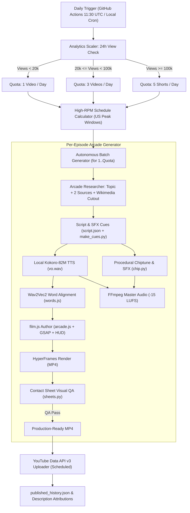

# 🚀 IMPLEMENTATION PLAN: ARCADE MOTION GRAPHICS & DYNAMIC VIEW-BASED AUTOPILOT

## 1. Executive Summary & Architecture Shift

This repository is transitioning from a legacy 4K long-form + 5 generic shorts generator into an ultra-fast, 100% $0 cost, anti-slop **Arcade Motion Graphics (8-bit Video Game Style)** autonomous YouTube channel engine.

### Current Architecture (Legacy Slop Pipeline)
- Generates 1 massive 4K/1440p 16:9 Ifverse/TED-Ed video (taking up to 3 hours).
- Splits/renders 5 generic vertical shorts (`shorts_generator.py`) regardless of channel growth or view performance.
- Relies on complex three.js/canvas setups with high rendering overhead.

### Target Architecture (Arcade Motion Graphics Engine)
- **Engine Core**: 100% free local deterministic pipeline based on `kit/arcade.js`, `hyperframes`, `gsap`, `Kokoro-82M` local voiceover, `torchaudio` forced alignment, procedural `numpy/scipy` chiptune synthesis, and `FFmpeg`.
- **Render Speed**: 1–2 minutes per 30–60s video (900–1800 frames at 30 fps), taking <15 minutes total daily pipeline time.
- **Dynamic View-Based Scaling Engine**:
  - **Tier 1 (<20k views in 24h)**: 1 video daily.
  - **Tier 2 (≥20k views in 24h)**: 3 videos daily.
  - **Tier 3 (≥100k views in 24h)**: 5 shorts daily.
- **US Tier-1 High-RPM Scheduling**:
  - Dynamically calculates publication timestamps targeted at peak Tier-1 viewer times (US Eastern: 12:00–15:00 EST and 19:00–22:00 EST).
- **Dual-Source Fact-Checking & Anti-Slop Integrity**:
  - 100% verified facts with `SOURCES.md` logging.
  - Real archival & Wikimedia Commons cutouts processed with `matte_white.py` and scanned into pixel worlds.

---

## 2. End-to-End Pipeline Data Flow

---

## 3. Module & File Specifications

| File Path | Role | Description |
|-----------|------|-------------|
| `skills/arcade-motiongraphics/` | Engine Vendor | Complete verified skill: `kit/`, `tools/`, `reference/`, `SKILL.md`. |
| `pipeline/analytics_scaler.py` | Quota Scaler | Queries YouTube Data API v3 for view counts of videos published in the last 24h. Returns 1, 3, or 5. |
| `pipeline/high_rpm_scheduler.py` | Smart Scheduler | Calculates exact ISO 8601 publication timestamps for US Eastern peak windows (12-3 PM & 7-10 PM EST). |
| `pipeline/arcade_researcher.py` | Topic & Asset Agent | Sourced from Tech/Founder origin stories; verifies 2 sources (`SOURCES.md`); downloads Wikimedia Commons cutouts. |
| `pipeline/arcade_film_writer.py` | Visual Code Generator | Generates dynamic `film.js` with Health Bar, Coin Counter, level progression, and scanlines. |
| `pipeline/visual_qa.py` | Multimodal QA Gate | Produces contact sheets via `sheets.py` and inspects frame quality before upload approval. |
| `pipeline/arcade_orchestrator.py` | Master Orchestrator | Replaces `run_daily_v2.py`. Wires the entire pipeline end-to-end with `--dry-run` support. |
| `.github/workflows/daily_video_v2.yml` | Cloud Autopilot | Daily GitHub Actions workflow running in <15 minutes at $0 cost. |

---

## 4. Acceptance Criteria & Verification Matrix

1. **Local & Cloud Reproducibility**: Pipeline executes without external paid API keys or paid video generators.
2. **Deterministic Pacing**: Every spoken keyword lands on exact `words.json` millisecond timestamps.
3. **Sound Standards**: Audio loudness mastered to -15.0 LUFS with sidechain ducking and soft chiptune harmonics.
4. **Dynamic Quota Compliance**: Correctly schedules 1 video (tier 1), 3 videos (tier 2), or 5 shorts (tier 3) based on real/mocked 24h view analytics.
5. **High-RPM Scheduling**: All YouTube uploads carry scheduled publish times aligned with US Eastern peak traffic.
